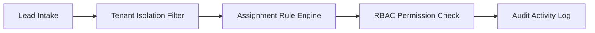

# Multi-Tenant Lead Management CRM Core (TypeScript / Node.js)


**Stack:** `TypeScript · Node.js · Multi-Tenant RBAC · Assignment Engine`

## Overview
A multi-tenant CRM domain engine providing tenant-isolated lead indexing, rule-based sales representative assignment, role-based access enforcement, and immutable activity timelines.

## Architecture & Execution Flow


## Key Engineering Capabilities
- **Tenant-Scoped Data Isolation:** Ensures lead queries, assignments, and updates never cross tenant boundaries.
- **Rule-Based Lead Assignment:** Routes incoming leads deterministically based on territory and workload rules.
- **Chronological Audit Timeline:** Appends immutable activity records for every status change and note.
- **Automated Test Suite:** Verified with `node --test` on Node.js 24.

## Local Verification
Run the self-contained verification suite locally:

```bash
node --test
```

## Documentation
- [Architectural Decisions](docs/DECISIONS.md)
- [Security & Isolation Model](docs/SECURITY.md)
